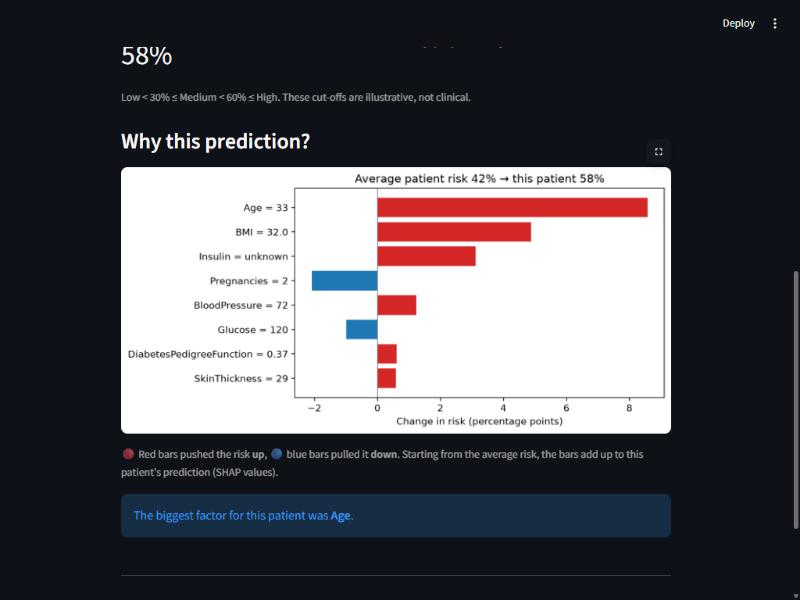
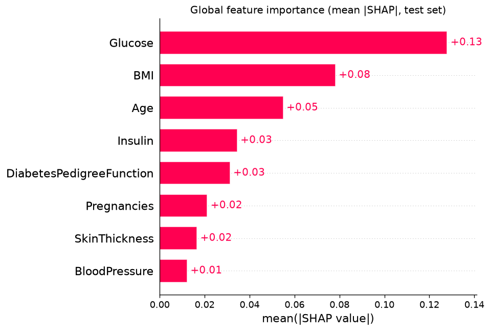
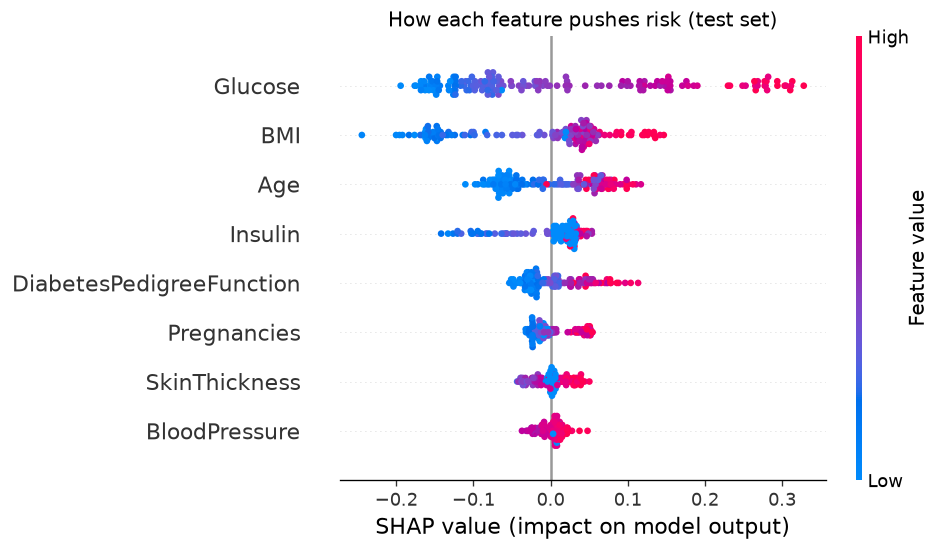
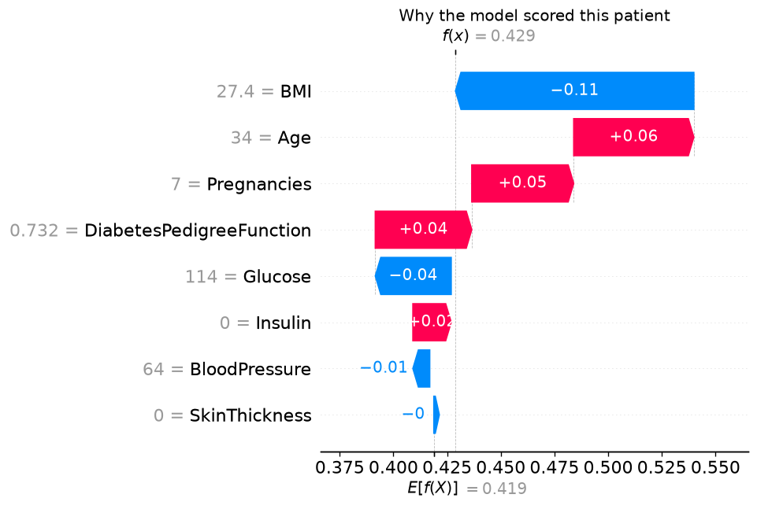

# 🩺 Diabetes Risk Predictor with Explainable AI

[](https://github.com/shukla-devansh/diabetes-risk-predictor/actions/workflows/ci.yml)


A machine learning web app that predicts a patient's risk of diabetes from 8 routine health measurements and **explains every prediction**, showing which factors pushed the risk up or down.

**Highlights:** Random Forest with **76% recall / 0.82 ROC-AUC** · per-patient SHAP explanations · Streamlit app · leakage-free sklearn pipeline · 10 pytest tests · GitHub Actions CI



> ⚠️ **Not medical advice.** This is a learning project on a small public dataset, not a diagnostic tool.

---

## Problem

Type 2 diabetes is often caught late because early screening is inconsistent. A model that flags high-risk patients from cheap, routine measurements could help clinicians decide who needs a follow-up blood test. But in healthcare a bare risk score isn't enough: clinicians need to know **why** the model flagged someone before they can trust it. This project pairs a predictive model with SHAP explanations to provide both.

## Dataset

[Pima Indians Diabetes Database](https://www.kaggle.com/datasets/uciml/pima-indians-diabetes-database) (National Institute of Diabetes and Digestive and Kidney Diseases): **768 women** of Pima heritage aged 21+, with 8 features (pregnancies, glucose, blood pressure, skin thickness, insulin, BMI, diabetes pedigree function, age) and a binary `Outcome`.

Key findings from [the EDA notebook](notebooks/eda.ipynb):
- **Imbalanced classes:** 34.9% diabetic, so accuracy alone is misleading.
- **Hidden missing values:** zeros in Glucose, BloodPressure, SkinThickness, Insulin and BMI are physically impossible. Insulin is missing for **48.7%** of patients and SkinThickness for 29.6%.
- **Glucose is the strongest signal** (correlation 0.47 with the outcome), followed by BMI and Age.

## Approach

1. **Cleaning** ([src/data.py](src/data.py)): impossible zeros → missing → filled with the column median. The medians are learned from the **training set only** inside an sklearn `Pipeline`, which prevents data leakage.
2. **Split:** 80/20, **stratified** so both sets keep the same ~35% diabetic share.
3. **Models** ([src/train.py](src/train.py)): Logistic Regression vs. Random Forest, both with `class_weight="balanced"`. The winner is chosen by **5-fold cross-validated recall** on the training set, so the test set stays untouched until the final evaluation.
4. **Explainability** ([src/predict.py](src/predict.py)): an exact, model-agnostic **SHAP** explainer over the whole pipeline, so the explanations refer to the raw values a user types in.

## Results

Test set (154 patients, never seen during training or model selection):

| Model | CV Recall | Accuracy | Precision | **Recall** | F1 | ROC-AUC |
|---|---|---|---|---|---|---|
| Logistic Regression | 0.701 | 0.734 | 0.603 | 0.704 | 0.650 | 0.813 |
| **Random Forest** ✅ | **0.771** | 0.734 | 0.594 | **0.759** | **0.667** | **0.819** |

**Why recall is the headline metric:** in screening, a *missed* diabetic (false negative) goes home untreated, while a *false alarm* only costs a follow-up blood test. Random Forest catches **41 of the 54** diabetic patients in the test set, compared with 38 for Logistic Regression.

### What drives the predictions (SHAP)

| Global importance | Direction of each feature's effect |
|---|---|
|  |  |

Glucose dominates, followed by BMI and Age, which matches the EDA. High values (red dots) of these features push risk up.

A single patient explained step by step, from the average risk to her prediction:



This diabetic patient scored only 43% (a **false negative**): her below-average BMI (27.4) and glucose (114) pulled the risk down. Explanations like this make the model's blind spots visible instead of hiding them.

## How to run

Requires **Python 3.11**. On Windows:

```bash
git clone https://github.com/shukla-devansh/diabetes-risk-predictor.git
cd diabetes-risk-predictor
py -3.11 -m venv .venv
.venv\Scripts\activate
pip install -r requirements.txt

streamlit run app.py          # launch the web app (trained model is included)
pytest                        # run the 10 tests

python -m src.train           # optional: retrain and compare models
python -m src.explain         # optional: regenerate the SHAP charts
python -m src.predict         # optional: explain one example patient in the terminal
```

On macOS/Linux, use `python3.11 -m venv .venv` and `source .venv/bin/activate`.

## Project structure

```
├── app.py                 Streamlit app
├── data/diabetes.csv      Pima dataset
├── notebooks/eda.ipynb    Exploratory data analysis
├── src/
│   ├── data.py            Loading, zero→median cleaning pipeline, stratified split
│   ├── train.py           Train, compare and save the best model
│   ├── predict.py         Predict risk + SHAP explanation for one patient
│   └── explain.py         Global and per-patient SHAP charts
├── models/                Saved pipeline (model.joblib) + metrics.json
├── reports/figures/       SHAP charts
├── tests/                 pytest suite
└── .github/workflows/     CI: runs pytest on every push
```

## What I learned

- **Metric choice is a product decision.** Accuracy was identical for both models (0.734); recall and the cost of a missed case decided the winner.
- **Data leakage is easy to introduce.** Filling missing values *before* splitting quietly leaks test information, and wrapping preprocessing in a `Pipeline` prevents it.
- **"0" doesn't always mean zero.** Domain knowledge (nobody has a BMI of 0) revealed that nearly half of the insulin values were missing.
- **Overfitting:** an unconstrained Random Forest memorizes 614 rows. Limiting `max_depth` and `min_samples_leaf` kept train/test accuracy at 0.85 vs. 0.73.
- **Explainability builds trust.** SHAP turns "58% risk" into "mostly because of age and BMI", which a clinician can sanity-check.
- Engineering basics: pinned dependencies, tests, CI and a reproducible project layout.

## Limitations

- **Small dataset:** 768 rows, and a 154-patient test set means each metric has a wide margin of error.
- **Possible bias:** the data covers only Pima women aged 21+, so the model may not generalize to men, other ethnicities or younger people. It should never be used across populations without being re-validated.
- **Heavy missing data:** half of the insulin values are imputed with a median, which hides real variation.
- **Probabilities are not calibrated:** `class_weight="balanced"` pushes scores upward to favor recall, so "58%" means higher risk than average, not a literal 58% chance. The Low/Medium/High cut-offs are illustrative.
- **Dated, single-source data:** a real clinical tool would need modern, diverse data, external validation and regulatory review.

## Tech stack

Python · pandas · scikit-learn · SHAP · Streamlit · matplotlib · joblib · pytest · GitHub Actions
